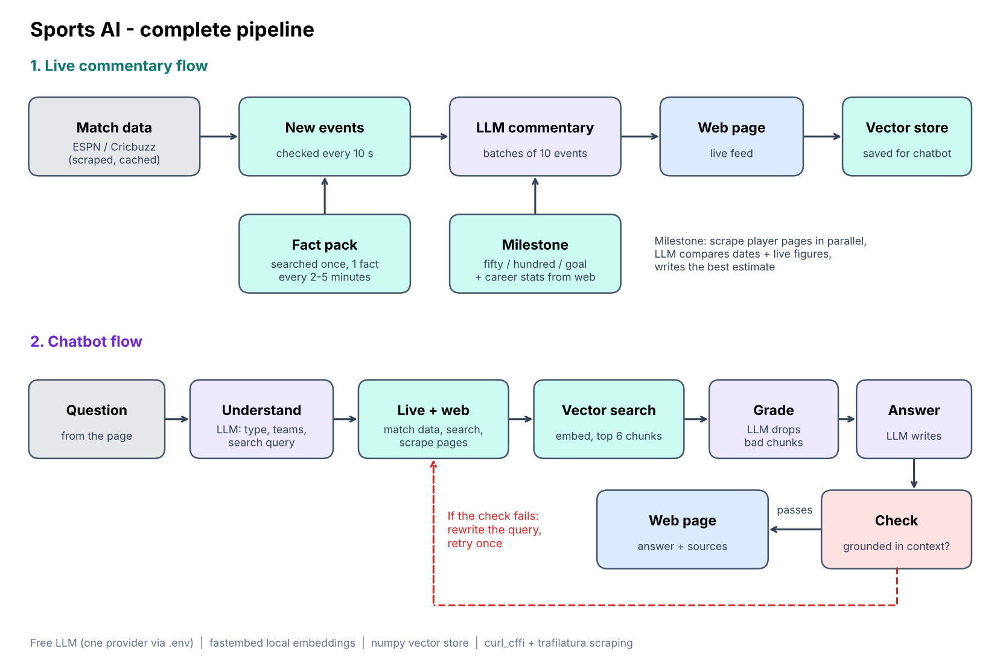

# Live Sports AI

Live commentary and a chatbot for cricket, football, basketball and tennis. Pick a match, watch the commentary update, and ask questions about any current or past game.

I built this as a study project and it runs on free tools only: a free LLM API, local embeddings, and scraped public data.



## What it does

- Lists today's matches for the four sports, live ones first.
- Writes commentary for the selected match every few seconds from its play-by-play feed.
- Drops in a match fact every 2 to 5 minutes (head to head, form, player records) instead of dumping everything at once.
- When something big happens, like a fifty or a goal, it looks up that player's career numbers and adds a note.
- The chatbot answers from live match data plus web search, and shows its steps and sources.

## Run it

```bash
pip install -r requirements.txt
cp .env.example .env
uvicorn main:app --port 8080
```

Open `http://localhost:8080`.

In `.env` you only need a key for one LLM provider. The defaults are set up for Groq's free tier, but any OpenAI-compatible API works if you change the base URL and model.

## How the chatbot works

1. The LLM reads the question and picks out the teams and a search query.
2. It pulls live match data and scrapes a few web pages.
3. Pages are split into chunks, embedded locally, and the closest ones are found with a cosine search.
4. The LLM drops chunks that don't help, then writes the answer.
5. A second check makes sure the answer is supported by the text. If not, it rewrites the query and tries once more.

## Files

| File | What it does |
|---|---|
| `main.py` | API endpoints |
| `sports.py` | Match data from ESPN and Cricbuzz |
| `commentary.py` | Live commentary loop |
| `match_facts.py` | Fact pack and milestone notes |
| `player_stats.py` | Career stat sources for a player |
| `qa.py` | Chatbot pipeline |
| `rag.py` | Small vector store (numpy) |
| `scrape.py` | Search and page fetching |
| `llm.py` | LLM client |
| `index.html` | The web page |

## Things to know

- Football, basketball and tennis data comes from ESPN's unofficial JSON, and cricket is scraped from Cricbuzz. Either can change without notice, so `sports.py` is the first place to look if something breaks.
- Cricket and tennis have less detail than football and basketball. Tennis only has score changes, not point by point.
- Milestone career stats are an estimate. The LLM compares several scraped pages, so a number can occasionally be off.
- Cloud servers are sometimes blocked by Cricbuzz and search engines. It works best from a home connection.
- There is no rate limit, so add one before sharing a public link.
